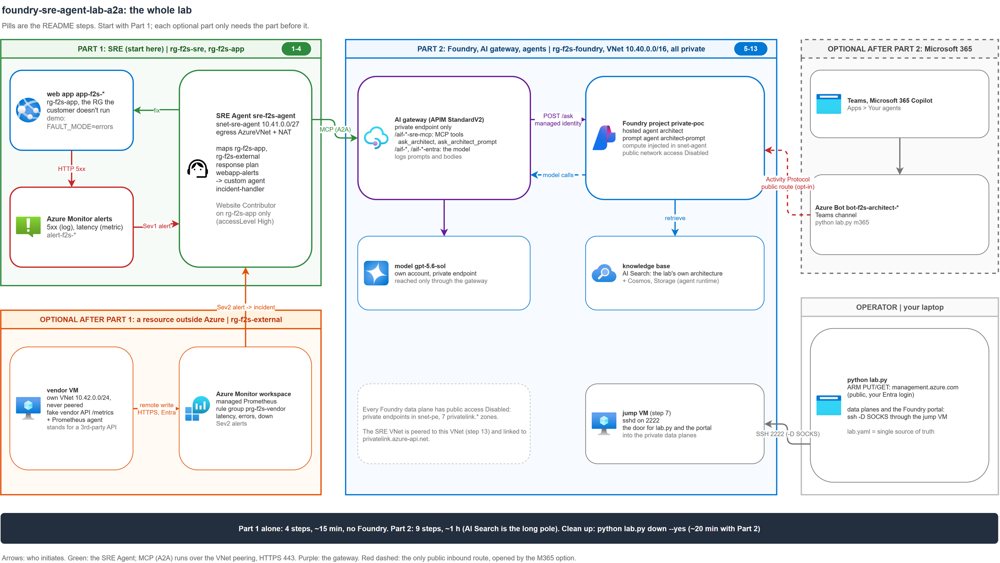
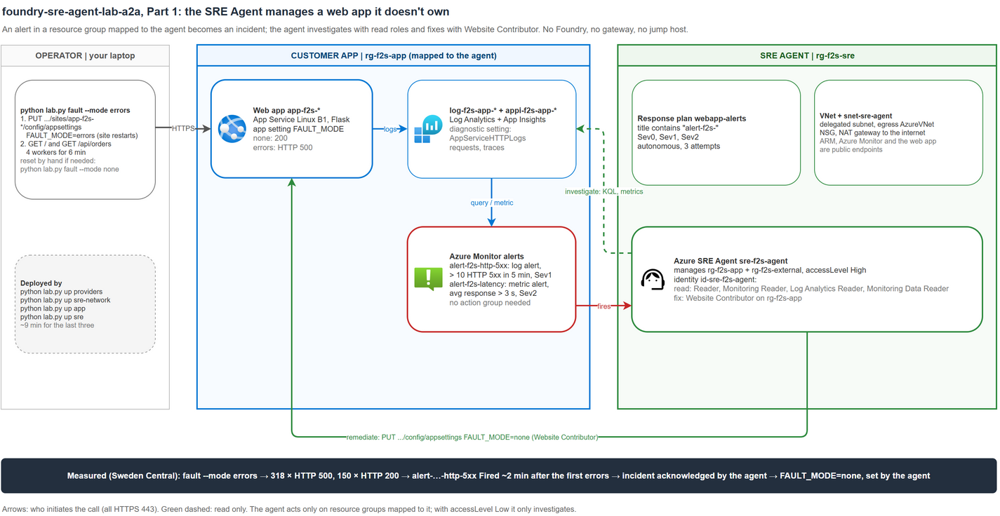
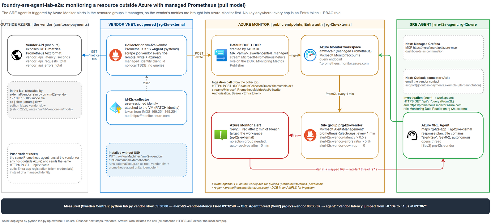
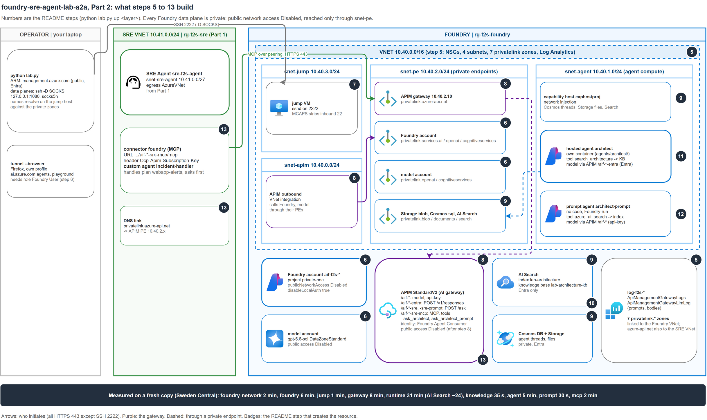
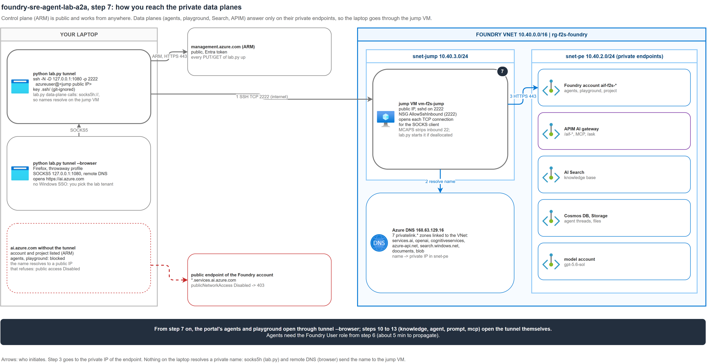
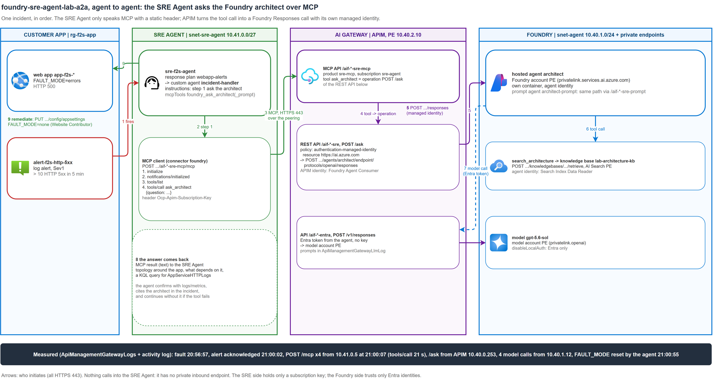
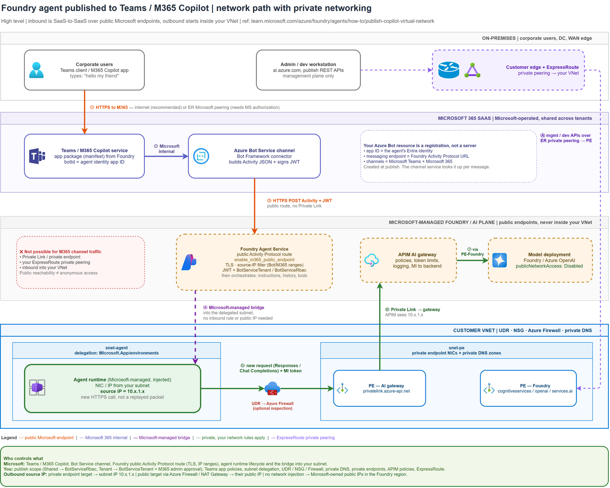

# foundry-sre-agent-lab-a2a

A hands-on lab for **Azure SRE Agent** and **Microsoft Foundry agents**, and the agent-to-agent
call between them. It covers:

1. **A minimal SRE Agent deployment.** The agent manages a web app the customer doesn't run themselves:
   the app's resource group is mapped to the agent, and an Azure Monitor alert on the app becomes an
   incident the agent investigates and fixes on its own.
2. **A private Foundry deployment behind an AI gateway.** Foundry account and project, a hosted agent and
   a prompt agent, the model reached only through API Management (APIM), everything on private endpoints.
3. **Agent to agent.** During an incident, the SRE Agent calls the Foundry hosted agent as an MCP tool
   on the private AI gateway, and gets an answer grounded in the lab's own architecture.

Plain Python with raw ARM and data-plane REST: no Bicep, no `az`, no SDK classes. `lab.yaml` is
the single source of truth; resource names derive from its `namePrefix` (`f2s` below).

| Part | What it shows | When |
|---|---|---|
| **Part 1: SRE** | alert on the web app → incident → the agent investigates and resets the fault | start here |
| optional: external resource | an alert on a vendor API outside Azure, through managed Prometheus | after Part 1 |
| **Part 2: Foundry** | AI gateway, private hosted and prompt agents; the SRE Agent asks them through MCP | to explore the AI side |
| optional: Microsoft 365 | the Foundry agent in Teams and Microsoft 365 Copilot (opens a public route) | after Part 2 |



## Portals

| Portal | URL | What you see there |
|---|---|---|
| Microsoft Foundry | https://ai.azure.com | the `aif-f2s-*` account and project: agents, model deployments, traces. Public access is off, so the data views (agents, playground) only load from a network that reaches the private endpoint (for example through the jump VM: `ssh -D` and a browser using SOCKS5 with remote DNS). |
| Azure SRE Agent | https://sre.azure.com | `sre-f2s-agent`: incident threads, response plans, connectors (MCP), mapped resource groups |
| Azure portal | https://portal.azure.com | the `rg-f2s-*` resource groups. Azure Monitor → Alerts; the `amw-f2s-*` workspace → Prometheus explorer; APIM → APIs and logs |

Sign in with the account in the tenant from `lab.local.yaml`.

## Before you start

The tenant and subscription are not in git. Put them in `lab.local.yaml` (git-ignored), or set
`AZURE_TENANT_ID` and `AZURE_SUBSCRIPTION_ID`. `azureConfigDir` in that file picks the az profile
(`AZURE_CONFIG_DIR`) that is logged in to the tenant, so switching tenant means rewriting one file:

```powershell
pip install -r requirements.txt
Copy-Item lab.local.example.yaml lab.local.yaml   # then fill in tenantId, subscriptionId, azureConfigDir
# to find the values, for example:
az account show --query "{tenantId:tenantId, subscriptionId:id}" -o yaml
az login --tenant <tenantId>                       # lab.py uses the az CLI login
python lab.py status                               # prints the target line, then one line per layer
```

Every command first checks the target: it requests the token for `tenantId` (whatever the az default
subscription is), checks the token's `tid` claim and `GET /subscriptions/{id}`, and prints
`target: tenant … | subscription … | az profile …`. If you have several tenants, each with its own
az profile (`AZURE_CONFIG_DIR`), a wrong profile stops the run before any change, with the
`az login --tenant` command that fixes it.

How to run the steps below:
- One command per step; check the result before going to the next.
- Every step is idempotent: if it fails, fix the cause and run the same command again.
- `--dry-run` on any `up` prints the requests without changing anything.
- `python lab.py status` tells you at any time which layers are done and which command comes next.
- `up` refuses a step whose prerequisites are missing and prints the command to run first.

Times are from our runs in Sweden Central.

## Part 1: SRE (start here)

Only the SRE VNet, the web app and the agent: no Foundry, no gateway, no jump host.



The agent can only see and fix what is in a resource group mapped to it: `app.resourceGroup` and
`external.resourceGroup` in `lab.yaml`. It can investigate with read roles only (`sre.accessLevel: Low`);
fixing needs `High`, which grants `sre.remediationRoles` on the app's resource group only.
Mapping a resource group also puts every alert of its subscription in front of the agent (it polls
Azure Monitor per subscription); the response plan `webapp-alerts` picks which ones it handles: Sev0-Sev2
whose title contains `alert-f2s-`. The roles it gets, and at which scope: [docs/reference/sre.roles.md](docs/reference/sre.roles.md).
What it costs: [docs/reference/sre.pricing.md](docs/reference/sre.pricing.md). The alert rules, who
creates them and the fault-to-fix timeline: [docs/reference/sre.alerts.md](docs/reference/sre.alerts.md).

**1. Providers** (~2 min): registers the resource providers, once per subscription.

```powershell
python lab.py up providers
```

Check: `status` shows `ok   providers  all registered`.

**2. SRE network** (≤ 3 min): `rg-f2s-sre`, NSG, NAT gateway, VNet with the agent subnet.

```powershell
python lab.py up sre-network
```

Check: `status` marks `sre-network` `ok`.

**3. Web app** (~8 min): demo web app in `rg-f2s-app`, App Insights, 5xx and latency alerts.

```powershell
python lab.py up app
```

Check: `status` marks `app` `ok`; in the Azure portal, the web app and its two alert rules.

**4. SRE Agent** (~3 min): SRE Agent mapped to `rg-f2s-app` and `rg-f2s-external`, response plan.

```powershell
python lab.py up sre
```

Check: https://sre.azure.com shows `sre-f2s-agent`.

Steps 2 to 4 in one run took about 9 minutes:

```powershell
python lab.py up sre-network app sre
```

### See the SRE Agent work

```powershell
python lab.py fault --mode errors
```

1. Sets `FAULT_MODE=errors` on the web app (`PUT .../sites/<app>/config/appsettings`), waits for the
   restart, then sends `GET /` and `GET /api/orders` for 6 minutes.
2. The 5xx alert `alert-f2s-http-5xx` fires and a new incident thread appears in https://sre.azure.com.
3. The agent investigates and resets the fault. If it doesn't, reset it by hand:

```powershell
python lab.py fault --mode none
```

Measured with Part 1 only: 318 responses 500 and 150 responses 200 during the run, the alert fired
about 2 minutes after the first errors, the agent acknowledged it and set `FAULT_MODE` back to `none`.

## Optional after Part 1: a resource outside Azure

A vendor API the customer doesn't run, seen only through its metrics. The metrics go to managed
Prometheus in Azure Monitor, so an alert on them reaches the SRE Agent like the web app's alerts.
Everything lives in `rg-f2s-external`, which Part 1 already mapped to the agent. The vendor runs on
its own small VM, in a VNet of its own (10.42.0.0/24) that is never peered: nothing from Part 2 is needed.



**1. External resource** (~3 min): vendor VNet and VM (sshd on 2222), Azure Monitor workspace,
collector identity, fake vendor + Prometheus agent installed by Run Command, Prometheus alert rules.

```powershell
python lab.py up external
```

Check: `status` marks `external` `ok`; the run ends with `vendor-sim: active | prometheus-agent: active`.

**2. The vendor answers** (ssh to the vendor VM, `GET 127.0.0.1:9105/metrics`):

```powershell
python lab.py vendor
```

Check: `mode=ok` and `vendor_api_latency_seconds` around 0.12.

**3. Metrics arrive in Azure Monitor** (`GET {query endpoint}/api/v1/query`, PromQL):

```powershell
python lab.py promql 'up{job="vendor"}'
```

Check: one series `collector=vm-f2s-vendor` with value `1`.

### See the SRE Agent work

```powershell
python lab.py vendor slow
```

1. Writes `slow` to `/var/lib/vendor-sim/mode` on the vendor VM: latency goes to about 1.8 s.
2. After 2 minutes of breach, `prg-f2s-vendor/alert-f2s-vendor-latency` fires (Sev2) and a new
   incident thread appears in https://sre.azure.com.
3. The agent queries PromQL itself and reports the latency jump. The fix is outside Azure, so it
   doesn't change anything here. Recover by hand (the alert resolves itself after 10 minutes):

```powershell
python lab.py vendor ok
```

Measured: alert fired 3 to 5 minutes after `vendor slow`, and the agent acknowledged it 30 to 90 seconds later.

Remove only this part (`rg-f2s-external` stays, it is still mapped to the agent):

```powershell
python lab.py down external --yes
```

## Part 2: Foundry, AI gateway and agents

To explore the private side: a Foundry hosted agent and a prompt agent side by side, published as
MCP tools on a private AI gateway (APIM). During an incident, the SRE Agent asks the hosted agent
about the architecture.

The lab's own flows:

```
SRE Agent (snet-sre-agent, 10.41.0.0/27) --peering--> APIM PE 10.40.2.x (privatelink.azure-api.net)
  APIM /<aif>-sre-mcp/mcp  (tools ask_architect, ask_architect_prompt; Ocp-Apim-Subscription-Key)
    -> /<aif>-sre POST /ask -> hosted agent "architect" (APIM managed identity, Foundry Agent Consumer)
         -> search_architecture -> Foundry IQ knowledge base (AI Search PE, Entra)
         -> model via APIM /<aif>-entra/v1/responses (Entra token, no key) -> gpt model account PE
    -> /<aif>-sre-prompt POST /ask -> prompt agent "architect-prompt" (same identity, same endpoint shape)
         -> azure_ai_search tool -> index lab-architecture (project connection, Entra)
         -> model via connection <aif>/gpt-5.6-sol -> APIM /<aif>/deployments/.../chat/completions (api-key)

Azure Monitor alert (app in rg-f2s-app, the "customer" RG the agent manages)
  -> SRE Agent incident -> response plan -> custom agent incident-handler -> MCP tool foundry_ask_architect
  -> remediation on the app (Website Contributor on rg-f2s-app)
```

Every hop is HTTPS on TCP 443 and is initiated by the calling side. SRE to Foundry is private.
Foundry to SRE Agent is not: the SRE Agent has no private inbound endpoint.

What steps 5 to 13 build (badges are the step numbers):



Who can call what, and with which identity: [docs/reference/foundry.roles.md](docs/reference/foundry.roles.md)
and [docs/reference/gateway.roles.md](docs/reference/gateway.roles.md).

**5. Foundry network** (≤ 3 min): `rg-f2s-foundry`, NSGs, VNet, private DNS zones, Log Analytics.

```powershell
python lab.py up foundry-network
```

Check: `status` marks `foundry-network` `ok`.

**6. Foundry** (~6 min): model account and deployment, Foundry account and project, private endpoints,
and the **Foundry User** role for you on the Foundry account (agents and playground in the portal).

```powershell
python lab.py up foundry
```

Check: `status` marks `foundry` `ok`; https://ai.azure.com lists the account. Its agents and playground
views stay closed until step 7: the data plane only answers on the private endpoint.

**7. Jump VM** (~1 min): Ubuntu VM with SSH on 2222, the door into the private network.

```powershell
python lab.py up jump
python lab.py tunnel        # check: opens without errors, Ctrl+C to close
```

Check: the tunnel opens.

How the laptop reaches the private data planes from here:



From here the portal works too. Open a browser through the tunnel (throwaway profile, names resolved
on the jump host against the private zones); it lands on https://ai.azure.com in the lab tenant, then
`private-poc` → Agents:

```powershell
python lab.py tunnel --browser
```

It opens `browser:` from `lab.local.yaml` (`firefox` or `edge`), else the first one found, Firefox
first. Prefer Firefox: Edge signs in with your Windows work account on its own, often the wrong tenant;
the Firefox profile has no Windows single sign-on, so you pick the lab tenant's account.

If it says "You don't have permission to build agents in this project", the role from step 6 is
still propagating: wait about 5 minutes and reload.

**8. AI gateway** (~8 min, APIM creation sometimes ~17): API Management AI gateway, private endpoint, model APIs.

```powershell
python lab.py up gateway
```

Check: `status` marks `gateway` `ok`; Azure portal: APIM → APIs.

**9. Runtime** (~30 min, mostly AI Search provisioning): storage, Cosmos DB, AI Search (all private), capability host.

```powershell
python lab.py up runtime
```

Check: `status` marks `runtime` `ok`. What each of the three services holds and who uses it at run time:
[docs/reference/foundry.runtime.md](docs/reference/foundry.runtime.md).

**10. Knowledge** (~1 min): the knowledge base about this lab's architecture.

```powershell
python lab.py up knowledge
python lab.py retrieve "flows"
```

Check: `retrieve` returns hits.

**11. Hosted agent** (~5 min): hosted agent `architect`.

```powershell
python lab.py up agent
python lab.py ask "what's in the architecture?"
```

Check: `ask` answers.

**12. Prompt agent** (~30 s): prompt agent `architect-prompt`.

```powershell
python lab.py up prompt
python lab.py ask --prompt "what's in the architecture?"
```

Check: `ask --prompt` answers.

**13. MCP bridge** (~2 min): peering and DNS link to the SRE VNet, both agents as MCP tools on the gateway, the SRE Agent's connector, skill and custom agent `incident-handler`.

```powershell
python lab.py up mcp
python lab.py mcp "which PE fronts the gateway?"
python lab.py sre-test
```

Check: `mcp` answers and `sre-test` succeeds.

`up mcp` adds the connector to the SRE Agent from Part 1, plus the custom agent `incident-handler`
(`sre/incident-handler.md`), and hands the response plan `webapp-alerts` to it. A skill alone is
optional to the agent: in our first run it fixed the app setting without asking the architect. The
custom agent's instructions make the call step 1. In the portal: **Build + setup** > **Workflows** >
Agent Canvas shows `webapp-alerts` → `incident-handler` (Autonomous, 8 tools, the two
`foundry_ask_architect*` marked MCP). Run the same `fault` demo again:



Check it in the gateway logs: `POST /mcp` from the SRE Agent subnet, then `/ask` from APIM and the
architect's model calls. Measured on our copy: alert acknowledged 3 min after the fault, `tools/call`
5 s later (21 s), FAULT_MODE reset by the agent 48 s after that.

```kql
ApiManagementGatewayLogs | where TimeGenerated > ago(1h) | where ApiId contains "-sre" or ApiId endswith "-entra" | project TimeGenerated, ApiId, Method, ResponseCode, CallerIpAddress, TotalTime | order by TimeGenerated asc
```

To read the prompts and answers themselves, and the tokens per caller, see
[docs/reference/gateway.kql.md](docs/reference/gateway.kql.md).

## Optional after Part 2: Microsoft 365

The `architect` agent in Teams and Microsoft 365 Copilot. This opens a public route.



The agent runtime is injected into `snet-agent`, and its calls (model through the AI gateway, tools)
start there and reach the private endpoints in `snet-pe`. Inbound from Teams and Microsoft 365 is SaaS
to SaaS over public Microsoft endpoints (Bot Service channel → Foundry Activity Protocol route); no
private endpoint or ExpressRoute can carry it. Only that route becomes public, and only for Bot
Service with a valid token for this agent.

The portal's Publish button doesn't work when the project's public access is off, so `m365` runs the
[REST flow](https://learn.microsoft.com/azure/foundry/agents/how-to/publish-copilot-virtual-network)
through the tunnel: Azure Bot `bot-f2s-architect-<sfx>` with the Teams channel, the `activity`
protocol on the agent, then `POST {project}/agents/architect/microsoft365/publish`.

```powershell
python lab.py m365                                      # Shared: only you, Teams/Copilot > Apps > Your agents
python lab.py m365 --scope Tenant --app-version 1.0.1   # org-wide after admin.cloud.microsoft approval
```

The bot goes with `rg-f2s-foundry` at teardown; remove the Teams app by hand.

## Clean up

Deletes every resource group, purges soft-deleted resources, then audits leftovers (about 20 min
with Part 2, the capability host is the long pole):

```powershell
python lab.py down --yes
```

Only the external resource:

```powershell
python lab.py down external --yes
```
